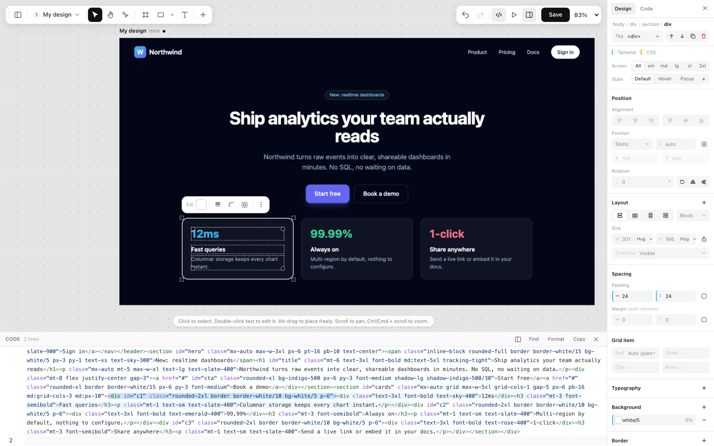
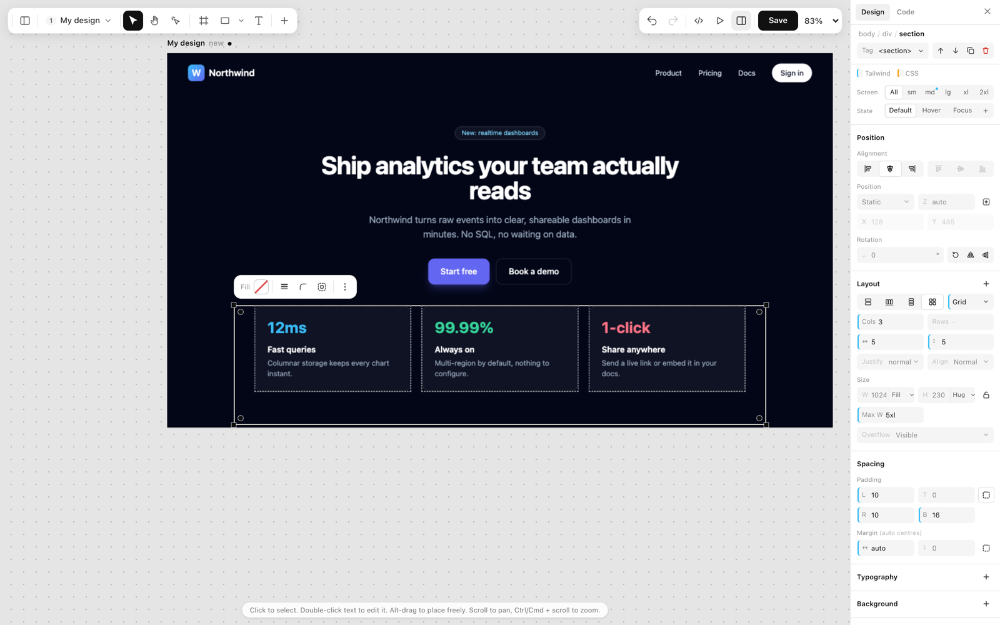
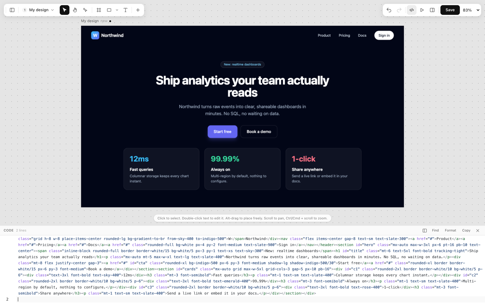
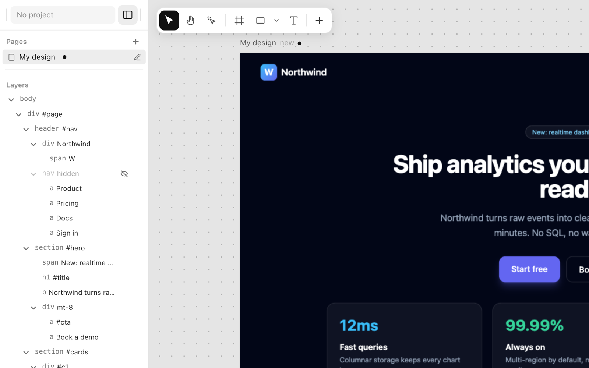
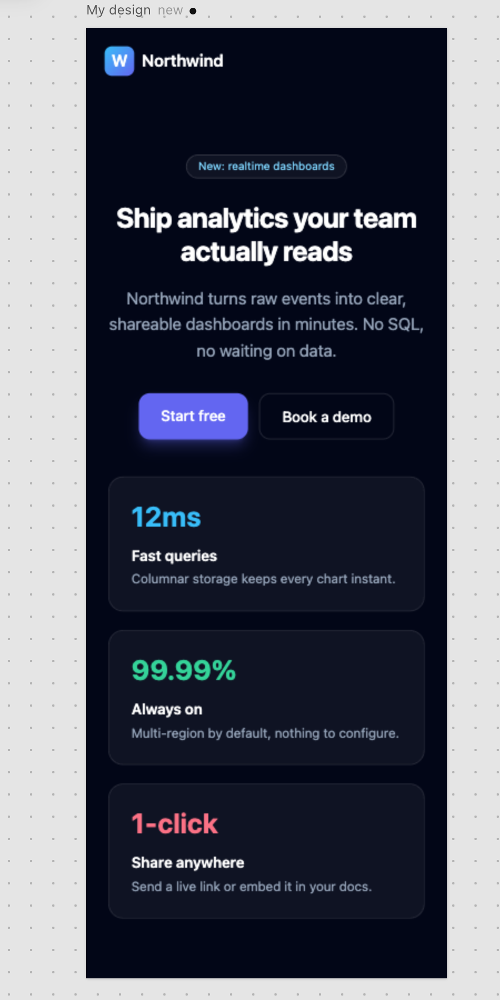

<div align="center">


### Design in Tailwind. Keep it as code.

**A visual design editor where every click writes real Tailwind HTML.**<br>
Select, drag and style like Figma. Generate with AI. Hand the result to your codebase, or to a coding agent, as it is.

[](https://www.npmjs.com/package/windcraft-editor)
[](https://nodejs.org)
[](https://tailwindcss.com)
[](#features)
[](https://www.figma.com/community/plugin/1697363010304569719)
[](LICENSE)

[**Try it live**](https://windcraft.swapniljadhav.com/) · [Watch the demo](docs/media/windcraft-demo.mp4) · [Features](#features) · [Quick start](#quick-start) · [npm](https://www.npmjs.com/package/windcraft-editor) · [MCP](#connect-claude-claude-code-or-cursor-mcp) · [Embed](#use-the-editor-in-your-own-app) · [Contribute](#contributing)

<br>

[](docs/media/windcraft-demo.mp4)

<sub>Click the demo to watch the full minute (MP4).</sub>

</div>

<br>

## Why Windcraft?

Most design tools end in a hand-off: a picture of the thing, rebuilt by someone in code. Most AI tools end in a block of output you can only fix by asking again. Windcraft skips both: every page is plain HTML with Tailwind classes, and every control reads and writes those classes. Make the padding bigger and `p-4` becomes `p-6`. Pick a colour and `bg-rose-500` changes.

|  | Figma | AI design tools | **Windcraft** |
|---|:---:|:---:|:---:|
| Edit visually: select, drag, resize, align | ✅ | ⚠️ ask again | ✅ |
| Describe it and have it drawn | ⚠️ some | ✅ | ✅ Claude or your own local model |
| What you end up with | a file to rebuild | generated output | **HTML + Tailwind you ship** |
| Start from a Figma design | native | varies | ✅ free plugin, editable code |
| Edit the code, design follows | ❌ | varies | ✅ |
| A coding agent can read and change it | ⚠️ limited | varies | ✅ over MCP |
| Runs on your own server | ❌ | ❌ | ✅ |

## See it

<p align="center">
  
  <br><sub><b>Select a card</b> and the Properties panel shows its Tailwind values, while the code below highlights the exact element.</sub>
</p>

<table>
  <tr>
    <td valign="top">
      
      <br><b>Selection like Figma.</b> Click picks the top box, double-click goes one level in. The box you picked shows what it holds as dashed outlines.
    </td>
    <td valign="top">
      
      <br><b>Code and canvas in step.</b> Edit the HTML and the design follows. Edit the design and the code follows. Undo covers both.
    </td>
  </tr>
  <tr>
    <td valign="top">
      
      <br><b>Layers and pages.</b> Every element in a tree, every page on one infinite canvas.
    </td>
    <td valign="top">
      
      <br><b>Responsive by design.</b> Switch to Tablet or Mobile, or drag to any width. Edits land in the right breakpoint (<code>md:p-8</code>).
    </td>
  </tr>
</table>

## Features

| | |
|---|---|
| 🖱️ **Direct manipulation** | Move, hand, interact, frame, rectangle, oval, line, arrow, text. Drag, resize, rotate, snap with distance guides, nudge with arrow keys, duplicate, group, copy and paste, lock and hide. |
| 🎛️ **Properties panel** | Every field is a Tailwind class, edited at its source. Breakpoints `sm` to `2xl` and states (`hover`, `focus`). Smart values: `16px` becomes `p-4`, an off-scale value becomes `rounded-[10px]`. Select many, change one field, one undo. |
| 🧩 **Live code panel** | Docked left or below. Click an element and its code lights up. Edit text in place with a floating bar. Paste HTML from anywhere. |
| 🎨 **Figma import** | A free plugin converts a selection to HTML + Tailwind **on your computer: no LLM, no network, no picture fallback**. Auto Layout becomes flex, text and vectors carry over. See [packages/figma](packages/figma/README.md). |
| 🤖 **AI generation** | Describe a page. **Anthropic Claude** or any **OpenAI-compatible local model** (Ollama, LM Studio, vLLM) drafts it with your project's tokens and best-matching components. |
| 🔌 **MCP server** | Claude, Claude Code and Cursor can read your design system and write pages straight into your projects. Tools: `get_design_guide`, `search_components`, `save_pages`, `apply_design_patch` and more. The **Connect** page walks you through it. |
| 🗂️ **Projects and sharing** | One look per project (brand scale, gray, font, radius). Share link, full-screen prototype view, export to HTML, React, Vue or Svelte, version history, and a gallery of designs. |

## Connect Claude, Claude Code or Cursor (MCP)

Windcraft runs an [MCP](https://modelcontextprotocol.io) server, so your AI tools can read your design system and save pages into your projects. The server address is your Windcraft address plus `/mcp`:

```
https://your-windcraft-address/mcp          e.g. https://windcraft.swapniljadhav.com/mcp
```

**Claude on the web (claude.ai): no token**
1. Open **Settings → Connectors → Add custom connector**.
2. Paste the address above and press **Connect**.
3. Sign in to Windcraft and press **Allow**.
4. Ask Claude: *"Use my Windcraft projects to build a pricing page."*

**Claude Code: with an access token**
1. In Windcraft open the **Connect** page (`/connect`), choose **Claude Code** and create an access token. It is shown once.
2. Put it in your shell profile: `export TAILWIND_LIBRARY_TOKEN=<your token>`
3. Add the server:

```bash
claude mcp add --transport http tailwind-library https://your-windcraft-address/mcp \
  --header "Authorization: Bearer ${TAILWIND_LIBRARY_TOKEN}"
```

**Cursor and any other MCP client:** add an HTTP (streamable) server with the address above and the header `Authorization: Bearer <your token>`:

```json
{
  "mcpServers": {
    "windcraft": {
      "type": "http",
      "url": "https://your-windcraft-address/mcp",
      "headers": { "Authorization": "Bearer ${TAILWIND_LIBRARY_TOKEN}" }
    }
  }
}
```

The **Connect** page has a **Run test** button that checks the connection and says what to fix. Running it yourself? Claude on the web needs a public HTTPS address, so set `PUBLIC_URL` (see [Run the full app](#run-the-full-app)). The tools include `get_design_guide`, `search_components`, `get_component`, `save_design`, `save_pages` and `apply_design_patch`.

## Quick start

### Try the editor in 30 seconds (no database)

No install needed: **[open Windcraft live](https://windcraft.swapniljadhav.com/)**. To run the editor yourself, with no database:

```bash
git clone https://github.com/Tolaj/windcraft.git
cd windcraft
npm install
npm run demo
```

Open <http://localhost:4000/editor/demo/> (add `?theme` to see a project theme applied).

### Run the full app

You need Node.js 18+ and a MongoDB database (local or Atlas).

```bash
cp .env.example .env     # then fill in the values below
npm run dev              # http://localhost:3000
```

| Variable | What it is | Needed |
|---|---|---|
| `MONGO_URI` | MongoDB connection string | Yes |
| `SESSION_SECRET` | Secret that signs session cookies | Yes |
| `PORT` | Server port (default `3000`) | No |
| `PUBLIC_URL` | Public HTTPS address of the server. Needed for Claude on the web to connect over MCP; leave empty for local work | For MCP on the web |
| `ANTHROPIC_API_KEY` | Server-side key for Claude (people can also add their own in Settings) | For AI |
| `LLM_URL` | Endpoint of a local OpenAI-compatible model | For a local model |
| `ADMIN_EMAILS` | Who can open the admin pages | No |
| `GMAIL_ID`, `EMAIL_*` | Gmail OAuth, used to send sign-in verification codes | For sign-up emails |

For production, `npm start`. A `vercel.json` is included for Vercel.

### Build the Figma plugin

```bash
npm run build -w @windcraft/figma
```

In **Figma desktop**: *Plugins → Development → Import plugin from manifest…* and choose `packages/figma/dist/manifest.json`. Or install the published plugin from the [Figma Community](https://www.figma.com/community/plugin/1697363010304569719).

## Use the editor in your own app

The editor is on npm as [**`windcraft-editor`**](https://www.npmjs.com/package/windcraft-editor). Drop it into any page, with no backend and no build step. Save this as `index.html`, run `npx serve` next to it, and open the address it prints:

```html
<div id="root"></div>
<script type="module">
  import { startEditor } from "https://unpkg.com/windcraft-editor/editor/index.js";
  startEditor(document.getElementById("root"), {
    html: '<h1 class="p-10 text-4xl font-bold">Hello</h1>',
  });
</script>
```

Designs are saved in the browser. Prefer npm? `npm install windcraft-editor`, serve `node_modules/windcraft-editor` as static files and import `editor/index.js` from there. To save to **your own server**, or put the editor in just one part of a page, see the [full guide](packages/editor/README.md).

## How it is built

Windcraft is a monorepo of small packages around a Node app.

| Package | What it does |
|---|---|
| [`windcraft-editor`](packages/editor) | The visual editor (on npm): canvas, layers, Properties panel, code panel, pages. Host-agnostic. |
| [`@windcraft/core`](packages/core) | The Tailwind brain: class groups, property-to-class mapping, board layout, themes. Pure functions, heavily tested. Bundled into `windcraft-editor` when it is published. |
| [`@windcraft/figma`](packages/figma) | The Figma to Tailwind converter and plugin. Fixed rules, no LLM. |
| [`@windcraft/mcp`](packages/mcp) | The MCP protocol for Express, with nothing about what the tools do. |
| [`@windcraft/ai`](packages/ai) | Provider-neutral AI generation (Anthropic and OpenAI-compatible). |
| `src/` | The app: Express 5, Handlebars, MongoDB. Accounts, projects, the gallery, sharing, the MCP tools. |

**Stack:** Node.js · Express 5 · Handlebars · MongoDB (Mongoose) · Tailwind CSS · CodeMirror 6 · Anthropic SDK.

```bash
npm test            # unit tests for core, editor, ai, mcp and the Figma converter
npm run typecheck   # tsc over the whole repo
```

## Roadmap

- Drag-and-drop that works out the layout (flex, grid) from where you drop, as Figma's auto layout does (in experiment)
- Figma converter: constraints, lists, image crop, and responsive output
- Components and variants as first-class Windcraft components

## Contributing

Windcraft is MIT licensed and open to everyone. You do not need to ask first.

1. **Fork** the repo and `npm install`.
2. **Branch** (`git switch -c fix/thing`) and make your change.
3. **Test:** `npm test` and `npm run typecheck`.
4. **Open a pull request** into `main`.

Good places to start:
- Pick a [`good first issue`](https://github.com/Tolaj/windcraft/labels/good%20first%20issue) or a [`help wanted`](https://github.com/Tolaj/windcraft/labels/help%20wanted) issue.
- `main` is protected, so every change comes in through a pull request.
- [CONTRIBUTING.md](CONTRIBUTING.md) covers setup, the repo layout and the project's principles.
- Found a bug or have an idea? [Open an issue](https://github.com/Tolaj/windcraft/issues/new). A screenshot or short recording helps a lot.
- If you like it, a star helps other people find it.

## License

[MIT](LICENSE) © 2026 Swapnil Jadhav. Use it, change it, host it, sell what you build with it. Third-party code keeps its own licenses: [THIRD_PARTY_LICENSES.md](THIRD_PARTY_LICENSES.md).

<div align="center">
<br>
<sub>Built by <a href="https://github.com/Tolaj">Swapnil Jadhav</a>.</sub>
</div>
