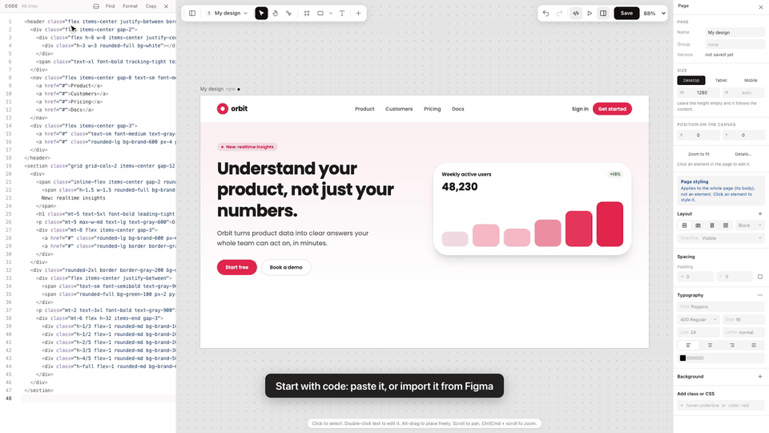

<div align="center">


### Design in Tailwind. Keep it as code.

**A visual design editor where every click writes real Tailwind HTML.**<br>
Select, drag and style like Figma. Generate with AI. Hand the result to your codebase, or to a coding agent, as it is.

[](https://nodejs.org)
[](https://tailwindcss.com)
[](#let-your-ai-tools-use-it-mcp)
[](https://www.figma.com/community/plugin/1697363010304569719)
[](LICENSE)

[**Watch the demo**](docs/media/windcraft-demo.mp4) · [Features](#features) · [Quick start](#quick-start) · [Figma import](#bring-a-design-in-from-figma) · [MCP](#let-your-ai-tools-use-it-mcp) · [Embed the editor](#embed-the-editor-in-your-own-app)

<br>

[](docs/media/windcraft-demo.mp4)

<sub>Click the demo to watch the full minute (MP4).</sub>

</div>

<br>

## What is Windcraft?

Most design tools end in a hand-off: a picture of the thing, rebuilt by someone in code. Most AI tools end in a block of output you can only fix by asking again.

Windcraft skips both. **The design *is* the code.** Every page is plain HTML with Tailwind classes, and every control in the editor reads and writes those classes. Make the padding bigger and `p-4` becomes `p-6` in the code beside it. Pick a colour and `bg-rose-500` changes. Nothing is stored in a format only Windcraft understands, so what you design is what you ship.

|  | Figma | AI design tools (Claude Design and similar) | **Windcraft** |
|---|---|---|---|
| Edit visually: select, drag, resize, align | Yes | Limited: mostly ask again | **Yes** |
| Describe it and have it drawn for you | Some AI features | Yes | **Yes** (Claude or your own local model) |
| What you end up with | A design file to rebuild | Generated output | **HTML + Tailwind: the code you ship** |
| Start from a Figma design | Native | Varies | **Yes, a free plugin turns it into editable code** |
| Edit the code and see the design follow | No | Varies | **Yes: the code panel and the canvas stay in step** |
| A coding agent can read and change it | Limited | Varies | **Yes, over MCP** |
| Runs on your own server | No | No | **Yes** |

## Features

### A canvas that behaves like Figma

- **Selection that works the way you expect.** One click picks the top-level box, double-click goes one level in, `Cmd/Ctrl`-click picks the deepest element, `Enter` / `Shift+Enter` walk in and out. The box you selected shows what it holds as dashed outlines that stay visible on dark and light backgrounds alike.
- **Pages on an infinite canvas.** Every page of a project sits on one plane, side by side, grouped into rows. Pan, zoom, rename, delete. Sections stack under their page. Nothing lands on top of anything else.
- **Real tools.** Move, hand, interact (try the page: hover, focus, clicks), frame, rectangle, oval, line, arrow, text, and an Add menu of ready blocks.
- **Direct manipulation.** Drag, resize and rotate with live size and angle readouts, snap to neighbours with distance guides, nudge with the arrow keys, duplicate, group, copy and paste, lock and hide layers.
- **Responsive by design.** Switch the frame between Desktop, Tablet and Mobile, or drag it to any width.

### A Properties panel where every field is a Tailwind class

- **Edited at its source.** A value set by a class changes that class. A value set by an inline style or your own CSS changes there. The panel tells you which, instead of quietly adding a second rule that fights the first.
- **Breakpoints and states.** Pick `sm` to `2xl`, `hover`, `focus` and friends and the edit lands in the right variant (`md:p-8`, `hover:bg-rose-600`). **All** writes one plain class for every size.
- **Smart values.** `16px` becomes `p-4`. A value Tailwind has no step for becomes an arbitrary one (`rounded-[10px]`, `opacity-[0.33]`) that works in every Tailwind version, and the panel notices when your theme changes what a class means.
- **Several elements at once.** Select many, change one field, and it is one undo step.
- **Everything you reach for:** layout (block, flex, grid), size (fixed, hug, fill, aspect ratio), spacing, position, typography, backgrounds and gradients, borders, outline, shadows and blur, blend modes, rotation and flip, transitions, cursor and visibility, plus a free **Add class or CSS** box.

### Code and design stay in step

- **A live code panel** beside the canvas, docked left or below. Click an element and its code lights up. Edit the code and the design follows. Undo and redo cover both.
- **Edit text in place** with a floating bar for size, weight, colour, alignment and links.
- **Paste HTML and go.** A whole page from anywhere, a component from another project, or a design from Figma.

### Bring a design in from Figma

A free Figma plugin converts a selection to HTML and Tailwind **on your own computer: no LLM, no network, no picture fallback.** Auto Layout becomes flex, gradients, strokes, shadows, masks and blend modes carry over, text keeps its font, size and spacing, vectors become inline SVG, and layers named like a button, nav or header become the matching real HTML elements. It does not paste a screenshot: you get code you can edit.

See [packages/figma](packages/figma/README.md) for exactly what converts and what does not yet.

### Let your AI tools use it (MCP)

Windcraft ships an [MCP](https://modelcontextprotocol.io) server, so Claude, Claude Code, Cursor and any other MCP client can **read your design system and write pages straight into your projects** instead of guessing at your style.

Tools include `get_design_guide`, `search_components`, `get_component`, `save_design`, `save_pages`, `apply_design_patch`, `get_context`, `create_project` and more. The **Connect** page in the app walks through Claude on the web, Claude Code and Cursor, and has a button to test the connection.

### AI generation that respects your look

Describe a page and Windcraft drafts it with **Anthropic Claude** or **any OpenAI-compatible local model** (Ollama, LM Studio, vLLM). The prompt carries your project's tokens and your best-matching components, so the result looks like your product, not like a template. The editor has an AI tab for changing the selected element by asking.

### Projects, themes and sharing

- **One look per project.** A brand colour (with its full `brand-50` to `brand-950` scale), a gray palette, a font and a corner radius, applied to the canvas, the previews and the exports alike.
- **Share link** and a full-screen **prototype view** that plays a project's pages one at a time.
- **Export** a design as HTML, React, Vue or Svelte.
- **Version history** with restore on every design.
- A **gallery** of designs by category to browse, copy from and start with.

## Quick start

### Try the editor in 30 seconds (no database)

```bash
git clone https://github.com/Tolaj/tailwind-ui-components.git windcraft
cd windcraft
npm install
npm run demo
```

Open <http://localhost:4000/editor/demo/> (add `?theme` to see a project theme applied). Designs are kept in your browser's local storage.

### Run the full app

You need Node.js 18+ and a MongoDB database (local or Atlas).

```bash
cp .env.example .env     # then fill in the values below
npm run dev              # http://localhost:3000
```

| Variable | What it is | Needed |
|---|---|---|
| `MONGO_URI` | MongoDB connection string | Yes |
| `SESSION_SECRET` | Secret that signs session cookies | Yes |
| `PORT` | Server port (default `3000`) | No |
| `PUBLIC_URL` | Public HTTPS address of the server. Needed for Claude on the web to connect over MCP; leave empty for local work | For MCP on the web |
| `ANTHROPIC_API_KEY` | Server-side key for Claude (people can also add their own in Settings) | For AI |
| `LLM_URL` | Endpoint of a local OpenAI-compatible model | For a local model |
| `ADMIN_EMAILS` | Who can open the admin pages | No |
| `GMAIL_ID`, `EMAIL_*` | Gmail OAuth, used to send sign-in verification codes | For sign-up emails |

For production, `npm start`. A `vercel.json` is included for Vercel.

### Build the Figma plugin

```bash
npm run build -w @windcraft/figma
```

In **Figma desktop**: *Plugins → Development → Import plugin from manifest…* and choose `packages/figma/dist/manifest.json`. Or install the published plugin from the [Figma Community](https://www.figma.com/community/plugin/1697363010304569719).

## Embed the editor in your own app

The editor is its own package with **no backend of its own**. Give it a host that loads and saves, and mount it:

```js
import { mountEditor } from "@windcraft/editor";

await mountEditor(document.getElementById("root"), {
    host,   // saving, projects, AI, delete: see packages/editor/design/host.js
    data,   // the design to open: { id, title, htmlCode, ... }
});
```

Need it inside a page section instead of owning the whole page? `embedEditor` puts it in an iframe with its own keys, zoom and styles, with a small API (`setHtml`, `getHtml`, `onChange`, `save`). See [packages/editor](packages/editor/README.md) and the working example in `packages/editor/demo`.

## How it is built

Windcraft is a monorepo of small packages around a Node app.

| Package | What it does |
|---|---|
| [`@windcraft/editor`](packages/editor) | The visual editor: canvas, layers, Properties panel, code panel, pages. Host-agnostic. |
| [`@windcraft/core`](packages/core) | The Tailwind brain: class groups, property-to-class mapping, board layout, themes. Pure functions, heavily tested. |
| [`@windcraft/figma`](packages/figma) | The Figma to Tailwind converter and plugin. Fixed rules, no LLM. |
| [`@windcraft/mcp`](packages/mcp) | The MCP protocol for Express, with nothing about what the tools do. |
| [`@windcraft/ai`](packages/ai) | Provider-neutral AI generation (Anthropic and OpenAI-compatible). |
| `src/` | The app: Express 5, Handlebars, MongoDB. Accounts, projects, the gallery, sharing, the MCP tools. |

**Stack:** Node.js · Express 5 · Handlebars · MongoDB (Mongoose) · Tailwind CSS · CodeMirror 6 · Anthropic SDK.

```bash
npm test            # unit tests for core, editor, ai, mcp and the Figma converter
npm run typecheck   # tsc over the whole repo
```

## Roadmap

- Drag-and-drop that works out the layout (flex, grid) from where you drop, as Figma's auto layout does (in experiment)
- Figma converter: constraints, lists, image crop, and responsive output
- Components and variants as first-class Windcraft components

## License

[MIT](LICENSE) © 2026 Swapnil Jadhav. Use it, change it, host it, sell what you build with it. Third-party code keeps its own licenses: [THIRD_PARTY_LICENSES.md](THIRD_PARTY_LICENSES.md).

## Contributing

Issues and pull requests are welcome. Run `npm test` and `npm run typecheck` before you send one.

<div align="center">
<br>
<sub>Built by <a href="https://github.com/Tolaj">Swapnil Jadhav</a>.</sub>
</div>
